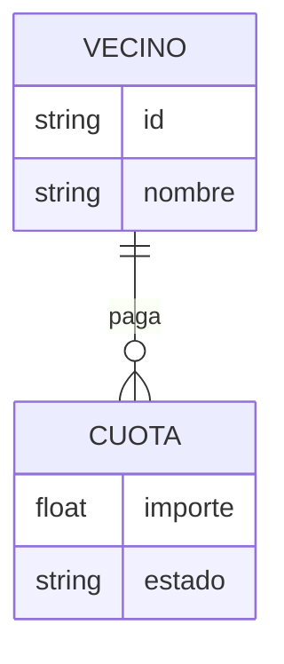

# 📌 Checkpoint 2: Análisis

¡Bienvenidos al segundo hito del Proyecto Intermodular! Una vez validada la definición del proyecto, entramos en la fase de **Análisis**. Aquí responderemos a la pregunta clave: **¿QUÉ debe hacer nuestra aplicación web?**

---

## 📋 ¿Qué debes entregar en este Checkpoint?

### 1. Identificación de Roles
Definición  de los diferentes tipos de usuarios que interactuarán con la plataforma y qué permisos generales tiene cada uno.
* ⚠️ **RECUERDA:** La aplicación debe contar con **al menos 3 roles diferenciados** (Usuario *Anónimo*, al menos un tipo de Usuario *Registrado* y usuario *Administrador*).

### 2. Requisitos Funcionales (RF)
Listado numerado y explicativo de todas las acciones, características y funcionalidades que el sistema debe permitir realizar.
* **Formato:** Cada requisito debe tener un código identificador (ej: `RF-01`, `RF-02`), un título claro que indique qué permite hacer.
* ⚠️ **RECUERDA** **NO incluyas Requisitos No Funcionales** (rendimiento, seguridad, tiempos de respuesta, etc.). Enfócate únicamente en definir **qué puede hacer cada usuario**.

👉 **[Consulta aquí ejemplos de Roles y Requisitos](GUIA-REQUISITOS-ROLES.md)**

### 3. Modelo Entidad-Relación (E/R)
Diseño del esquema conceptual de datos que dará soporte a la aplicación. Debe representar fielmente todas las entidades, sus atributos, relaciones y cardinalidades requeridas para cumplir con los Requisitos Funcionales (`RF`).
* ⚠️ **RECUERDA: SOLO se entregará el diagrama Entidad-Relación**. No se incluirá paso a Modelo Relacional, tablas ni claves primarias/foráneas en esta entrega.

* **Origen de datos:** Todas las entidades y sus atributos deben derivarse estrictamente de los `RF` definidos en el punto anterior. No añadas entidades no justificadas.
* **Herramientas:** Formato libre (Draw.io, StarUML, Lucidchart, Visio, etc.). Debe adjuntarse como una (o varias) imágenes claras.
  * **Opción recomendada (Mermaid):** Se evalúa muy positivamente el uso de **Mermaid.js**. Permite definir el diagrama mediante código dentro del propio Markdown y GitHub lo renderiza automáticamente de forma nativa (sin subir imágenes ni perder resolución).
  * 🔗 **Guía rápida de sintaxis:** [Documentación oficial de Diagramas ER en Mermaid](https://mermaid.js.org/syntax/entityRelationshipDiagram.html)
  * 💡 **Ejemplo básico en Markdown:**

> 💡 **Nota de visualización:** Si el diagrama no carga en GitHub, se debe a las restricciones de seguridad del perfil de **Chrome con la cuenta de EducaAnd**. Para verlo correctamente, abre el enlace en **Firefox** o en un **Perfil de Invitado / Personal** de Chrome.
